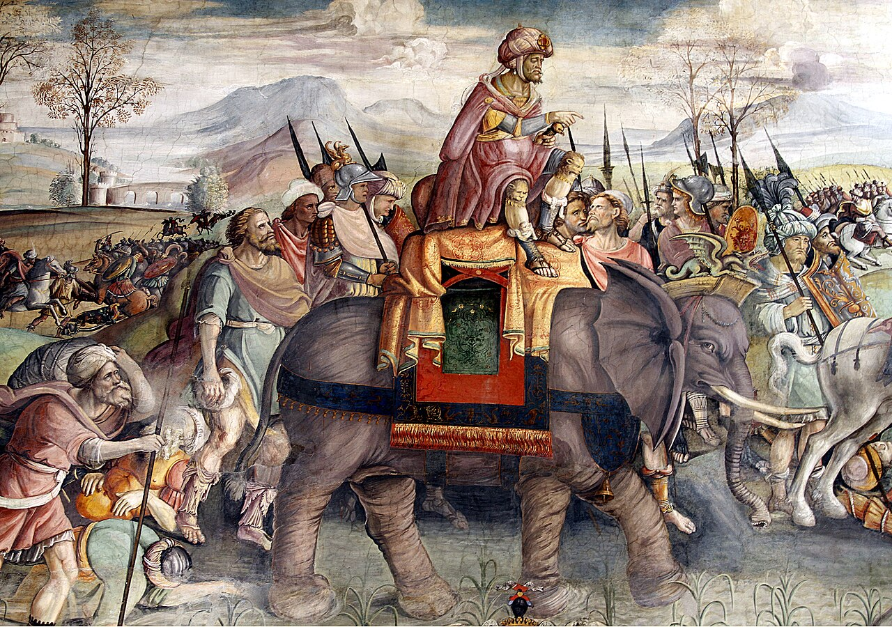
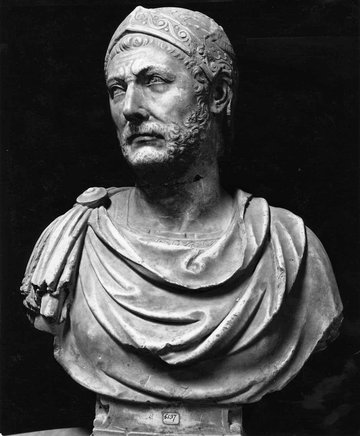
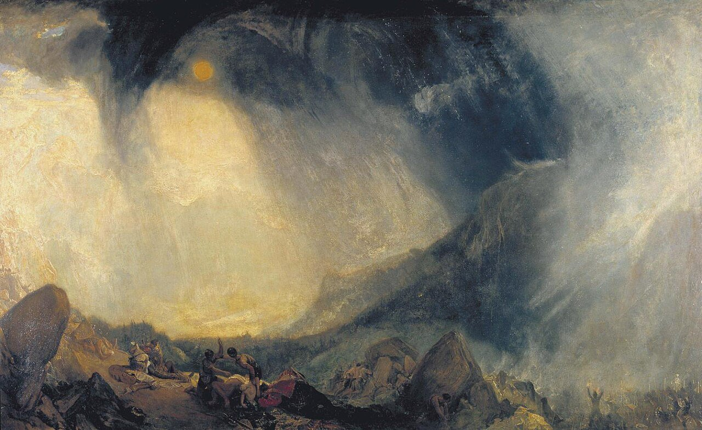
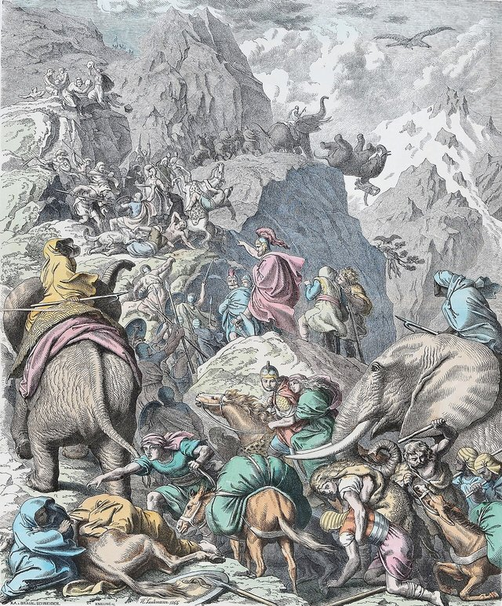
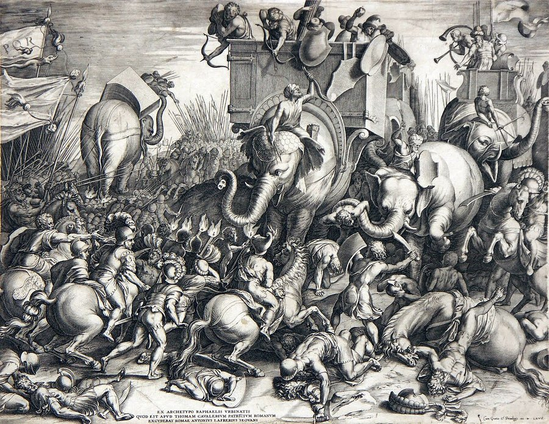

# Hannibal's Army

   

<p align="center">
  
  <br>
  <sub><i>Hannibal in Italy</i>, fresco attributed to Jacopo Ripanda, early 16th century, Palazzo dei Conservatori, Rome. The commander rides the biggest seat and points; everyone else has a job. Photo: José Luiz, CC BY-SA 4.0.</sub>
</p>

Hannibal's Army is a doctrine, prompt set and small Orca launcher for an orchestrator acting as the owner's stand-in. It
supports solo work and parallel workers, including overnight QA and fix loops on existing products. The launcher uses
Python's standard library: no dependencies, no server.

## Table of contents

- [Why Hannibal](#why-hannibal)
- [Why this exists](#why-this-exists)
- [How it works](#how-it-works)
- [Choosing workers](#choosing-workers)
- [A campaign, phase by phase](#a-campaign-phase-by-phase)
- [Quick start](#quick-start)
- [Requirements](#requirements)
- [Adapting your lineup](#adapting-your-lineup)
- [What's in the repo](#whats-in-the-repo)
- [Status](#status)
- [FAQ](#faq)
- [Credits](#credits)
- [License](#license)

## Why Hannibal



Military history is my hobby, and Hannibal is my favourite rabbit hole. Somewhere between reading about the Alps
crossing for the third time and babysitting four coding agents at once, I noticed the two problems rhyme. You have one
commander who has to keep the whole plan in his head, scouts who go ahead, troops from different places who are good at
different things, and a supply line that runs out at the worst possible moment. Swap "supply line" for "weekly quota"
and that's my week.

So the army got his name. Maharbal, his cavalry commander, gets credit for a useful reminder: a campaign isn't done when
the tests go green. The product still has to work for its users.

<br clear="right">

## Why this exists

A strong orchestrator plans, designs, triages and reviews while cheap models with high reasoning effort handle bounded
grunt work. Acting as the owner's stand-in, it judges changes from both the customer's and system's perspectives and
uses browser QA to check the product as a real user. The workflow addresses common failure modes:

| Failure | What it looks like |
|---|---|
| Cheap models designing | A vague spec leads a fast worker to build the wrong thing. |
| Unchecked changes | A fix passes its tests but fails when a customer uses the product. |
| "Started" isn't running | The worker is on the wrong model, or its task never got sent. |
| Two writers, one branch | Two agents edit the same files, and the merge eats one of them. |
| Green tests, broken system | Each module passes its own tests and the modules don't fit together. |
| The commander runs out of context | The lead agent forgets its own plan halfway through and starts over. |

<p align="center">
  
  <br>
  <sub><i>Snow Storm: Hannibal and his Army Crossing the Alps</i>, J. M. W. Turner, 1810–1812. The campaign can be harder than the plan.</sub>
</p>

Hannibal's Army answers each of these with a rule, and with a script check where one is possible. The rules come from 22
papers on multi-agent coding and from the ledger of a real multi-agent sprint where most of these went wrong (see
[Credits](#credits)).

## How it works

The orchestrator chooses and announces **Solo**, working directly with occasional help, or **Army**, using Orca workers
for independent parallel work or long overnight runs. It judges issues from the customer's and system's perspectives,
reviews each worker diff and steps in directly where needed.



For an existing project, the loop is browser QA → triage → reproduce → fix → browser QA. Agents use the product as real
users with synthetic accounts and only authorized side effects. Orca's built-in browser is preferred when available; the
owner's own Chrome is never used. Browser QA gates completion, alongside a green existing suite.

New systems retain architecture, contract, skeleton and task-card phases. Each worker has one worktree and a short brief
with setup, rules, scope and a user-facing check. The orchestrator's own fixes are reproduced and reviewed in the next
browser QA round. See [DOCTRINE.md](DOCTRINE.md) for the complete rules.

<br clear="right">

## Choosing workers

The default first choices are OpenCode 2 with DeepSeek free tier and Antigravity with Hydrogen; second choices are
Claude Haiku 5.5 and the latest GPT Luna. Use the highest supported reasoning effort. Session instructions override
the lineup; record exact model IDs from launch proof and never silently substitute. OpenCode model selection needs an
existing worktree and a verified CLI. Cheap workers stop and report when a general fix or design or library choice
needs judgment; the orchestrator designs it or assigns a stronger model. Where supported, it can promote the same
worker in place and verify the effective model; otherwise a stronger worker continues from its report.

Scipio is an optional red-team tester for higher-risk changes. Hasdrubal and Mago are optional sub-project leads only
when independent sub-projects each need an army and the orchestrator is measurably blocked. See the doctrine for limits.

## A campaign, phase by phase

For existing products, choose a mode, read the applicable rules, investigate, and search GitHub and the web for
maintained solutions before building. Brief workers where useful, then repeat browser QA, triage and fixes. Keep
separate evidence logs for each setup and report causes, rate-limit errors, slowest turns and created items.

For a new system, first write architecture and a versioned contract, prepare an importing or compiling skeleton with
failing contract tests, and make task cards. Merge providers before consumers, one at a time, with the full suite after
each merge. Browser QA still gates done. After QA passes and CI is green, push unless project rules say otherwise; never
force-push or add AI co-author trailers.

<p align="center">
  
  <br>
  <sub><i>Battle of Zama</i>, Cornelis Cort, 1567.</sub>
</p>

Campaign state, briefs, reports and handover live under the target repo's ignored `.army/<campaign>/`. Overnight runs
use a stoppable wake timer and one Orca inbox; the morning report covers changes, QA and decisions needed.

## Quick start

1. Install the skill by linking this repo into the skills folder of the agent you will start as orchestrator:

   | Agent | Skills folder |
   |---|---|
   | Codex | `~/.agents/skills/` |
   | Claude Code | `~/.claude/skills/` |
   | Antigravity | `~/.gemini/config/skills/` |
   | OpenCode | `~/.config/opencode/skills/` |

   ```bash
   ln -s /path/to/Hannibals-Army ~/.agents/skills/hannibals-army
   ```

   On Windows, use `New-Item -ItemType Junction` instead. Workers receive briefs and do not load the skill.
2. In Orca, open the target repo and ask the top-level agent to use `hannibals-army`, giving it the campaign name,
   goal, done condition, constraints and your worker model instructions. It chooses the mode and loads the doctrine.
3. Check `.army/<campaign>/log.md`, reports and handover for progress. The orchestrator uses git's info/exclude
   to keep campaign files out of commits. `python muster.py selftest` checks the launcher.

## Requirements

- The Orca desktop app, with its `orca` CLI on your PATH
- Logged-in agent CLIs appropriate to the chosen mode and owner instructions
- Python 3.10 or newer (standard library only)
- A git repository to campaign in

## Adapting your lineup

Session instructions can override the default lineup. Give cheap models clearly bounded work, keep one writer per
worktree, and use browser QA and orchestrator review of changes.

## What's in the repo

| Path | What it is |
|---|---|
| [`SKILL.md`](SKILL.md) | Short loader for the orchestrator |
| [`DOCTRINE.md`](DOCTRINE.md) | Modes, planning, QA, overnight operation and worker housekeeping |
| [`prompts/`](prompts/) | Orchestrator, worker, optional red-team and sub-project lead, brief and handover templates |
| [`muster.py`](muster.py) | Prompt assembly and worker launch |
| [`research/`](research/) | Historical research, proposal and debate records |
| [`assets/`](assets/) | Artwork credited below |

## Status

The launcher help, self-test and prompt assembly have been checked. A live worker launch, overnight timer and full
end-to-end campaign have not been verified as part of this update. Historical research records earlier proposals;
[DOCTRINE.md](DOCTRINE.md) is the current workflow.

## FAQ

**Do I need several providers?**   No. Choose Solo or Army for the task; session instructions can override the default lineup.

**Who makes design and library choices?**   The orchestrator decides or assigns a stronger model, logging its choice.
Cheap workers report evidence rather than designing general fixes.

**Is this too much for one feature?**   Solo mode keeps a small task with one orchestrator; use workers when parallelism
or a long run helps.

**Why does the orchestrator read worker reports?**   It coordinates decisions and reviews the work. Reports are
evidence, not instructions overriding the task.

**How is a change reviewed?**   The orchestrator reviews worker diffs; its own changes are reproduced first and reviewed
in the next browser QA round. Browser QA is the completion gate for both.

**Does the theme leak into my codebase?**   The doctrine and orchestrator prompt carry the theme. Worker prompts and
campaign filenames use plain language.

## Credits

The doctrine is built on notes from 22 papers on multi-agent and strong/weak model collaboration in coding, including
Samway et al. on teams of coding agents, Kim et al. on scaling agent systems, MasDrift on depth and authorization drift,
SWE-Review, Co-Coder and Gandhi et al. on strong-weak collaboration. The notes, the evidence summary and the corrections
are in [`research/`](research/). These records document the earlier research, rather than the current operating rules.

Built for and on Orca, which does the hard part: running many agents from many vendors side by side, each in its own
worktree.

Artwork, via Wikimedia Commons. The fresco photo is CC BY-SA 4.0; the rest are public domain:

| Image | Artist | Year | Source |
|---|---|---|---|
| *Hannibal in Italy* (fresco), photographed by José Luiz | Attributed to Jacopo Ripanda | early 16th century; photo 2016 | [Commons](https://commons.wikimedia.org/wiki/File:Hannibal_in_Italy_by_Jacopo_Ripanda_-_Sala_di_Annibale_-_Palazzo_dei_Conservatori_-_Musei_Capitolini_-_Rome_2016_(2).jpg), photo licensed [CC BY-SA 4.0](https://creativecommons.org/licenses/by-sa/4.0/), resized to 1280 px |
| *Snow Storm: Hannibal and his Army Crossing the Alps* | J. M. W. Turner | 1810–1812 | [Commons](https://commons.wikimedia.org/wiki/File:Joseph_Mallord_William_Turner_081.jpg) |
| *Hannibals Übergang über die Alpen* (cropped) | Heinrich Leutemann | 1866 | [Commons](https://commons.wikimedia.org/wiki/File:Heinrich_Leutemann_-_Hannibals_%C3%9Cbergang_%C3%BCber_die_Alpen_(cropped).jpg) |
| *Battle of Zama* | Cornelis Cort | 1567 | [Commons](https://commons.wikimedia.org/wiki/File:Slaget_ved_Zama_-_Cornelis_Cort,_1567.jpg) |
| Bust of Hannibal from Capua (photograph) | Fratelli Alinari | c. 1900 | [Commons](https://commons.wikimedia.org/wiki/File:Hannibal_Barca_bust_from_Capua_photo.jpg) |

Doctrine, prompts and script by Abdullah Khan Sherwani.

## License

[MIT](LICENSE) © 2026 Abdullah Khan Sherwani

The MIT license covers the doctrine, prompts and script. The images in `assets/` keep their own licenses, listed in
[Credits](#credits).